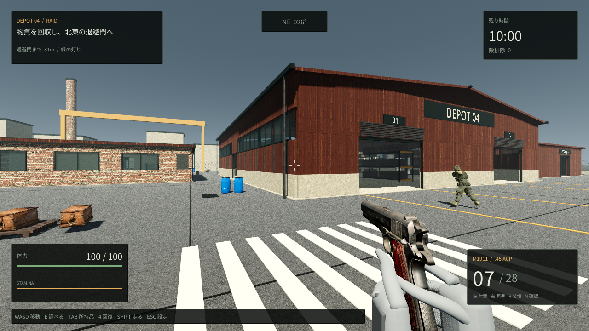

# ASHGATE / DEPOT 04

## UE5版（新規の初期プロトタイプ）

UE5 5.8.4 / C++版を [unreal/Ashgate](unreal/Ashgate/README.md) に追加しました。Godot版とは別に開発・配布・保存します。

**[UE5 Windows版（GitHub Releases）](https://github.com/shien0zero-ai/tst-game-real/releases/tag/ue5-prototype-2026-11-12)** — ZIPを全展開し、Ashgate.exeを起動します。Editorは不要です。

[実画面・検証結果・残作業](unreal/Ashgate/VALIDATION.md)を参照してください。まだ初期段階で、Bodycam相当の画質は未達です。以下は維持している既存Godot版の説明です。

M1911を携えて工業地帯を探索し、物資を回収して脱出する、1マップのソロPvEプロトタイプです。警備員との戦闘、有限の弾薬、治療、バッグの容量、脱出後の倉庫管理まで遊べます。既存のM1911モデルと武器確認モーションを引き継いでいます。



## Windowsですぐ遊ぶ

**[Windows版をダウンロード（ZIP）](https://github.com/shien0zero-ai/tst-game-real/raw/refs/heads/main/downloads/Ashgate-Depot04-Windows-x86_64.zip)**

Windows 10 / 11の64bit版向けです。遊ぶだけならGodotの導入、インストール作業、アカウント登録は不要です。

1. `Ashgate-Depot04-Windows-x86_64.zip` をダウンロードします。
2. ZIPを右クリックして **「すべて展開」** を選びます。
3. 展開先の **`Ashgate-Depot04.exe`** をダブルクリックします。
4. 拠点画面で **「DEPOT 04へ出撃」** を選びます。

更新時は新しいZIPを別のフォルダーに展開し、新しいEXEを起動してください。古いEXEは自動更新されません。同じWindowsユーザーで起動すれば、保管庫と感度設定を引き継ぎます。

配布版はCompatibility描画を使います。Windows用EXEはWineで起動を確認し、内蔵ゲームデータからもGodotの動作テストを通しています。Windows実機での描画・性能は未確認です。

## 最初の出撃

南西の検問所から始まります。倉庫や事務所、作業場のケースへ近づき、照準を合わせて **E** で調べます。回収した物資は **Tab** で確認できます。バッグを開いている間も敵は動き続けます。

脱出地点は **マップ北東の退避門** です。緑の灯りを目印に進み、門の前の塗装された区画内で **6秒間待機** すると脱出できます。範囲を離れると待機時間は最初からになります。出撃の制限時間は10分です。

脱出すると、装備中のM1911、残った装填弾・予備弾、バッグの中の回収品を倉庫へ保存し、300 CRを受け取ります。拠点では回収品を売却し、銃・弾薬・救急キットを補充できます。

死亡、時間切れ、出撃中のゲーム終了では、持ち込んだ装備と回収品を失います。出撃前から倉庫に置いてあった物資は残ります。装備も購入資金も足りなくなった場合は、拠点で再出撃用の最低限のキットを受け取れます。

## 操作

| 操作 | キー |
| --- | --- |
| 移動 / 視点移動 | WASD・矢印キー / マウス |
| 走る / ジャンプ | Shift / Space |
| 単発射撃 | 左クリック |
| 照準を構える | 右クリックを押している間 |
| リロード | R |
| 銃の外観を確認 | N |
| ケース・敵のバッグを調べる | E |
| バッグを開く・閉じる | Tab |
| 治療を始める・中断する | 4 |
| バッグを閉じる / 一時停止・感度設定 | Esc |
| 射撃場だけをリセット | T |

M1911は1マガジン7発で、左クリックごとに1発撃ちます。PvEでは予備弾も有限です。出撃時は倉庫からM1911を1丁、弾薬を最大35発、救急キットを最大1個持ち出します。予備弾薬はバッグの12スロットとは別に携行します。

体力が減ったり出血したら、救急キットを使って治療できます。治療は2.4秒かかり、体力を45回復して出血を止めます。攻撃を受けると中断し、完了するまでキットは消費しません。走るとスタミナを使います。

Escの設定画面ではゲームを一時停止し、マウス感度を10〜300%に変更できます。設定はこのPCに自動保存されます。バッグ内でEscを押した場合は、先にバッグを閉じます。

拠点の射撃場ボタンから、以前の試射モードも遊べます。こちらでは予備弾が無制限です。Escの **「試射を終えて拠点へ戻る」** で拠点へ戻れます。

## 現在の内容

- 約96×88mの工業地帯1マップ。中央倉庫、事務所、作業場、コンテナ置き場、北東の退避門。
- 巡回し、視認や銃声に反応する8人の警備員。壁や遮蔽物は射線を遮ります。
- 13か所の物資ケースと、倒した敵が落とす物資。電子部品・工具・機械部品などを回収できます。
- M1911の射撃、ADS、リロード、反動、Nキーによる武器確認。
- 体力・出血・スタミナ、12スロットのバッグ、倉庫、売買、脱出報酬と装備喪失。

ソロで遊ぶ小規模なプロトタイプです。マルチプレイ、複数マップ、大規模な装備・改造システムは現在の範囲に含まれません。

## 保存データ

保管庫は `user://ashgate_profile_v1.json`、感度は `user://settings.cfg` に自動保存します。Windowsの通常の保存先は次の場所です。

```text
%APPDATA%\Godot\app_userdata\M1911 Firing Range\
```

以前の感度設定を引き継ぐため、保存フォルダー名には旧プロジェクト名を使っています。新規データはM1911×2、弾薬84発、救急キット×4、1,800 CRで始まります。

## 制作物・素材

コード・シーン・素材と変更履歴は [shien0zero-ai/tst-game-real](https://github.com/shien0zero-ai/tst-game-real) の `main` ブランチに保存します。

銃にはegorbelous（e.belous）制作の **「M1911 pistol」** を使用しています。作者の形状・UV・PBRテクスチャを保ち、ゲーム用の実寸・部品構成と反射の粗さへ調整しています。CC BY 4.0として公開再配布されていた素材を使用し、入手経路、作者、出典、変更内容と原典の確認状況を [M1911のクレジット](licenses/models/M1911.txt) に記載しています。詳しい変換仕様は [モデルノート](docs/MODEL-NOTES.md) を参照してください。

工業地帯のPBR素材・小物・警備員モデルの出典と変更内容は [素材クレジット](licenses/raid/THIRD_PARTY.txt) に収録しています。手袋付きの手と合成効果音はこのプロジェクトで制作しました。日本語フォントはNoto Sans CJK JPのOFLサブセットで、[フォントのライセンス](licenses/fonts/NotoSansCJK.txt) を同梱しています。配布ZIPにも素材とGodotのライセンスを収録しています。

## 開発する

編集にはGodot 4.6.3以降を使います。ソースはGDScriptで、標準の描画方式はForward+です。Godotのプロジェクトマネージャーで `project.godot` をインポートし、F5で拠点画面から実行できます。遊ぶだけなら開発環境は不要です。

```sh
godot --editor --path .
godot --path .

# Compatibility描画で起動する場合
godot --path . --rendering-method gl_compatibility

# シーン・ゲーム動作の確認
sh tools/check.sh
```

チェックでは、以前の射撃場の移動・射撃・遮蔽・設定・武器確認に加え、PvEの弾薬、物資回収、治療、バッグ、脱出、死亡時の装備喪失、保管庫の保存を確認します。ログと一時データは `work/godot/` に保存します。クラウドの描画確認にはCompatibilityとソフトウェアOpenGLを使います。実GPUでのForward+の描画品質と性能は別途確認してください。

| ファイル | 役割 |
| --- | --- |
| `scenes/raid_main.tscn` / `scripts/raid_session.gd` | 拠点から出撃・回収・脱出・帰還までの進行 |
| `scripts/raid_map.gd` | 工業地帯の地形・建物・衝突・経路探索 |
| `scripts/raid_enemy.gd` / `scripts/raid_enemy_visual.gd` | 警備員の行動・射撃・外観 |
| `scripts/raid_loot.gd` / `scripts/raid_inventory.gd` | 物資ケース、携行品、倉庫と保存 |
| `scripts/raid_ui.gd` | 拠点、戦闘HUD、バッグ、結果画面 |
| `scenes/player.tscn` / `scripts/player.gd` | 移動・視点・体力・治療・スタミナ |
| `scripts/weapon.gd` / `scenes/m1911_visual.tscn` | M1911の射撃・リロード・武器確認 |
| `scenes/main.tscn` | 以前の射撃場モード |
| `assets/raid/` | 工業地帯と警備員のモデル・PBR素材 |

1 Godot unit = 1mです。Blenderからはメートル単位の `.glb` で受け渡し、`.blend` の自動取り込みは使用しません。

モデル・フォント・効果音は同梱しています。再生成が必要なときだけ、対応する制作ツールを用意してください。

```sh
# M1911：Blender 4.3以降とPython 3
python3 tools/build_m1911.py

# 手袋付きの手：Blender
blender --background --factory-startup --python tools/build_hands.py

# 合成効果音：Python標準ライブラリ
python3 tools/build_audio.py

# 日本語フォント：Noto Sans CJKの元フォントとfontTools
python3 tools/build_ui_font.py --source /path/to/NotoSansCJK-Regular.ttc

# Windows配布ZIP：同じバージョンのGodotエクスポートテンプレート
python3 tools/build_windows.py --templates-dir /path/to/templates
```

Windows用ビルドは64bit EXEにゲームデータを内蔵し、操作説明・ライセンスとともに `downloads/Ashgate-Depot04-Windows-x86_64.zip` にまとめます。開発用のForward+設定を保ち、配布版にはCompatibilityを指定します。
