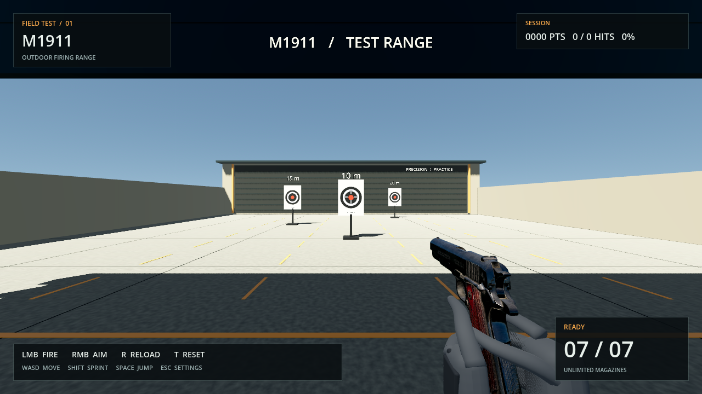
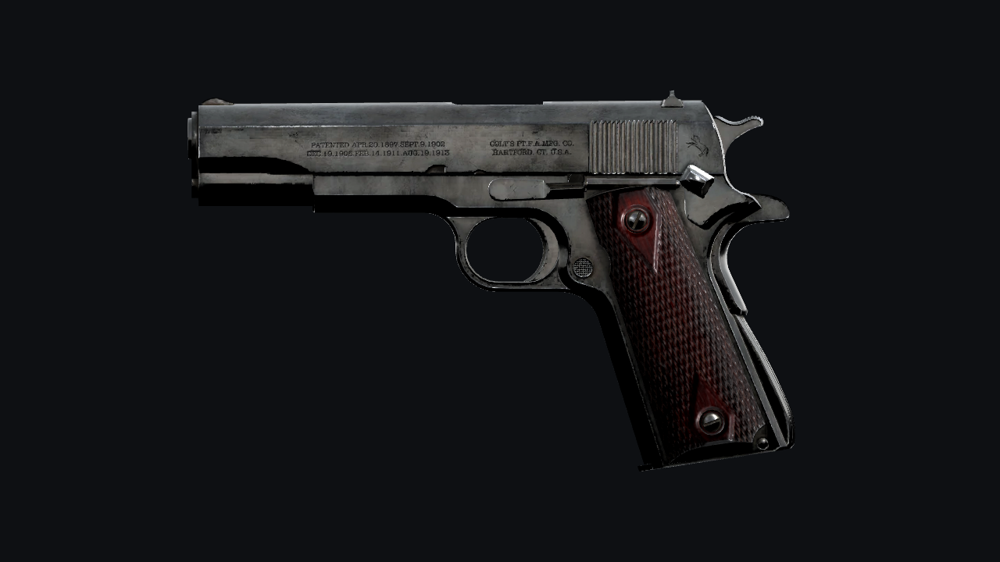
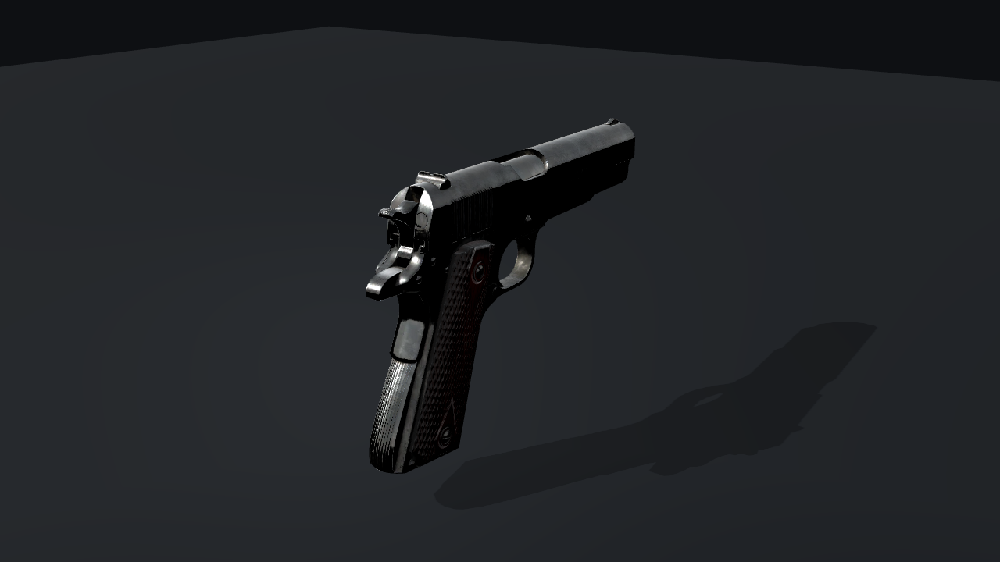
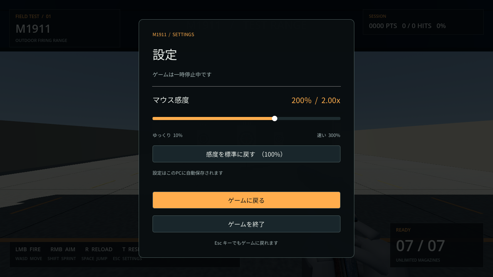

# M1911 試射プロトタイプ

M1911の3Dモデルと簡略化した操作感を組み合わせたゲーム用プロトタイプです。
構えて狙い、3枚の紙的へ試射できます。リアル寄りの3Dゲームを育てていくための最初のプレイ可能な土台です。

## Windowsですぐ遊ぶ

**[Windows版をダウンロード（ZIP）](https://github.com/shien0zero-ai/tst-game-real/raw/refs/heads/main/downloads/M1911-FiringRange-Windows-x86_64.zip)**

Windows 10 / 11 の64bit版向けです。プレイにはGodotの導入、インストール作業、アカウント登録は不要です。

1. 上のリンクから `M1911-FiringRange-Windows-x86_64.zip` をダウンロードします。
2. ZIPを右クリックし、**「すべて展開」**を選びます。
3. 展開したフォルダー内の **`M1911-FiringRange.exe`** をダブルクリックします。

以前の版を使っている場合は、新しいZIPをもう一度ダウンロードし、別のフォルダーに展開して新しいEXEを起動してください。古いEXEは自動更新されません。

左クリックで射撃、右クリックを押して照準、`R`でリロードします。**`Esc`で設定メニューを開き、マウス感度を変更できます。**
配布版は幅広いPCで起動しやすいCompatibility設定です。Windows実機での起動はまだ未確認のため、起動できない場合は表示されたエラーの文面を知らせてください。



プレビューはCompatibilityのソフトウェア描画で撮影しています。

今回の更新では、銃をegorbelous（e.belous）制作の「M1911 pistol」モデルへ置き換えました。部品ごとの形状、加工面の凹凸、局所的な金属の摩耗、木製グリップの木目や細工を、作者のUVと刻印を含むPBRテクスチャを保って取り込んでいます。射撃やリロード、感度設定などのゲームプレイ、音声、手のモデル、射撃場は従来どおりです。

以下は、形状と素材を確認するためにGodotのスタジオ照明で撮影したモデル単体の画像です。射撃場のゲーム画面とは照明が異なります。





形状・素材・制作上の仕様は[モデルノート](docs/MODEL-NOTES.md)にまとめています。銃モデルは[CC BY 4.0](https://creativecommons.org/licenses/by/4.0/)で提供された素材を使用し、作者・出典・変更内容を[モデルのクレジット](licenses/models/M1911.txt)に記載しています。

## 試せること

- 左クリックごとに1発撃つ単発射撃。発射音、マズルフラッシュ、反動、スライドの動きを確認できます。
- 右クリックを押している間は照準を構えます（ADS）。
- `Esc`でゲームを一時停止し、設定画面でマウス感度を10〜300%に調整できます。標準は100%で、変更はすぐに反映され、次回起動時にも引き継がれます。
- 作者が部品ごとに作り込んだM1911モデルです。金属の擦れ・反射の違い、木製グリップの木目や細かな凹凸を確認できます。
- 1マガジン7発。予備マガジンは無制限で、弾切れ後もリロードして試射を続けられます。
- 初期位置の前方10m・15m・20mに配置した紙的に弾痕が残ります。壁や障害物は射線を遮ります。
- 的の中心は10点、中の輪は7点、外の輪は4点、紙の端は1点。得点・発射数・命中数・命中率を表示します。
- `T` で開始位置、得点、命中記録、弾痕、装填状態をまとめてリセットできます。

## 制作物の保存先

GitHub: https://github.com/shien0zero-ai/tst-game-real

今後の制作物と変更履歴は、このリポジトリの `main` ブランチにコミット・プッシュして保存します。
プロジェクトの作業方針は `AGENTS.md` にも記録しています。

## 開発者向け：開発環境

- ソースプロジェクトは Godot 4.6.3 の **Forward+** を使います。上のWindows配布版を遊ぶだけなら、以下の開発環境は不要です。
- このクラウド作業環境には **Godot 4.6.3** と **Blender 4.3.2** が導入済みです。
- コードは GDScript。Node.js、npm、.NET は不要です。
- プロジェクトの場所：`/workspace/tst-game-real`
- ローカルPCで編集・プレイする場合は Godot 4.6.3 以降と、Forward+ に対応した Vulkan / Metal / Direct3D 12 のグラフィック環境が必要です。

## 開発者向け：Godotで開く・実行する

Godot のプロジェクトマネージャーで `project.godot` をインポートし、**F5** でメインシーンを実行します。
M1911を装備した状態で、射撃場のスタート位置に出現します。
最初の読み込み時は素材のインポートとシェーダーの準備を待ってください。

画面を使える端末では、プロジェクトのディレクトリで次のコマンドも使えます。

```sh
godot --editor --path .
godot --path .
```

次のコマンドで画面なしの動作チェックを実行できます。

```sh
sh tools/check.sh
```

シーンの読み込み、移動・衝突・ジャンプに加え、実際の発射入力、命中と得点、弾数、リロード中の発砲制限、リセット、障害物による射線の遮蔽、感度設定の保存とメニュー中の一時停止を確認します。
ログと一時データは `work/godot/` に保存されます。

このクラウド環境の画面確認には、仮想ディスプレイとCompatibility＋ソフトウェアOpenGLを使っています。Windows用の実行ファイルの起動・描画にはWindows互換環境も使用します。
実GPUによるForward+の描画品質と性能は、ローカルPCで確認してください。

## 操作

| 操作 | キー |
| --- | --- |
| 単発射撃 | 左クリック |
| 照準を構える（ADS） | 右クリックを押している間 |
| リロード | R |
| 射撃場をリセット | T |
| 移動 | WASD / 矢印キー |
| 視点移動 | マウス |
| 走る | Shift |
| ジャンプ | Space |
| 設定メニューを開く・閉じる | Esc |
| マウス感度を変更 | 設定画面のスライダー |

開始時はマウスをゲーム内に捕捉します。`Esc`で設定画面を開くとカーソルを操作でき、射撃場は一時停止します。
「マウス感度」のスライダーで10〜300%に調整し、「感度を標準に戻す」で100%に戻せます。設定はこのPCに自動保存されます。
`Esc`または「ゲームに戻る」で再開します。設定画面を操作するクリックでは発砲しません。
終了するときは、設定画面の「ゲームを終了」を選びます。
左クリックを押し続けても連射しません。空撃ちは発射数・命中率の集計に含みません。



## 編集する場所

| ファイル / フォルダー | 役割 |
| --- | --- |
| `scenes/main.tscn` | メインシーン。射撃場、3枚の的、プレイヤー、HUD |
| `scenes/firing_range.tscn` | 照明、空、床、壁、屋根、距離表示。エディタで配置を変更可能 |
| `scenes/player.tscn` | 身長1.8mの当たり判定と、目の高さ1.62mのカメラ |
| `scenes/m1911_visual.tscn` | フレーム・スライド・マガジンに分けたM1911の外観モデル |
| `scenes/fps_hands.tscn` | 銃を構える手袋付きの手 |
| `scenes/pause_menu.tscn` / `scripts/pause_menu.gd` | Escで開く設定画面、感度の反映・保存、一時停止と再開 |
| `scenes/target.tscn` | 紙的の見た目と衝突形状 |
| `scripts/player.gd` | 移動・視点・ジャンプ・視点の反動。速度とマウス感度はInspectorで調整可能 |
| `scripts/weapon.gd` | 単発射撃、射線判定、弾数、リロード、ADS、銃のアニメーション |
| `scripts/target.gd` | 的の得点判定、弾痕、命中回数 |
| `scripts/range_session.gd` | 発射数・命中数・得点の集計と射撃場リセット |
| `scripts/hud.gd` / `scripts/reticle.gd` | 弾数・集計表示、照準、命中フィードバック |
| `materials/` | 射撃場などのPBRマテリアル |
| `assets/models/` | Blenderから書き出す3Dモデル |
| `tools/source_assets/m1911/` | 銃を再出力するための同梱元モデルと出典情報 |
| `assets/textures/` | ベースカラー、ラフネス、法線などのテクスチャ |
| `assets/audio/` | オリジナルの合成発射音・リロード音・空撃ち音 |
| `assets/fonts/` | 設定画面用の同梱日本語フォント |
| `tests/smoke.gd` | 実際のシーンと物理演算を使う動作確認 |
| `tests/shooting.gd` | 発射入力・命中・弾数・リロード・リセット・遮蔽の動作確認 |
| `tests/settings.gd` | 感度の変更・保存・一時停止・設定画面中の入力制限の確認 |

1 Godot unit = 1m で作成しています。リアルな比率を保つため、モデルの寸法もメートルで揃えてください。
入力の変更は「プロジェクト → プロジェクト設定 → インプットマップ」で行えます。

## モデル・素材を再生成する

銃はCC BY 4.0のM1911モデルをゲーム用に変換したGLBです。作者の形状・UV・PBRテクスチャを使用しています。手のモデルと合成効果音はこのプロジェクトの制作物です。
モデル・テクスチャ・フォントは同梱しているため、プレイ時にBlenderやPythonを入れる必要はありません。

銃を再出力する場合は、制作環境にBlender 4.3以降とPython 3を用意します。同梱元モデルを使うため、素材のダウンロード、アカウント登録、NumPy・Pillowの導入は不要です。日本語フォントを再生成する場合のみ、Noto Sans CJKの元フォントとfontToolsが必要です。

```sh
# 同梱元モデルから銃のGLBとGodot用シーンを再出力
python3 tools/build_m1911.py

# 左右の手袋付きモデルを再生成
blender --background --factory-startup --python tools/build_hands.py

# 効果音を再生成（Python標準ライブラリのみ）
python3 tools/build_audio.py

# 日本語フォントを再生成（Noto Sans CJKの元フォントとfontToolsが必要）
python3 tools/build_ui_font.py --source /path/to/NotoSansCJK-Regular.ttc
```

`tools/build_m1911.py` は `tools/source_assets/m1911/m1911.glb` をBlenderで読み込み、実寸とゲーム内の配置へ変換してフレーム・スライド・マガジンの3つのGLBを書き出します。元のUV・法線・PBRテクスチャを保ち、既存の射撃・リロード用ノードに接続します。
書き出し後に `tools/share_m1911_textures.py` がPython標準ライブラリだけでGLB内の画像をバイト単位で取り出し、同一画像を `assets/textures/m1911_runtime/` に共有します。この共有工程では画像の再圧縮や形状の変更を行いません。出典・取り込み前の変換履歴は[元モデルの説明](tools/source_assets/m1911/README.md)を参照してください。
日本語フォントはNoto Sans CJK JPを元にしたOFLのサブセットで、ライセンスは `licenses/fonts/NotoSansCJK.txt` に収録しています。

外観モデルのシーン・マテリアル・テクスチャや効果音を直接編集した場合、再生成で上書きされます。
継続して調整する場合は、対応する生成スクリプトも更新してください。

## Blenderからモデルを取り込む

1. Blenderで単位系を Metric、Unit Scale を 1.0 に設定します。
2. モデルを作り、Object Mode で `Ctrl+A → Rotation & Scale` を適用します。
3. `File → Export → glTF 2.0` から **glTF Binary (.glb)** を選び、`assets/models/` に保存します。Principled BSDF の Metallic / Roughness を基準に素材を設定します。
4. Godotでインポートが終わったら、`.glb` をワールドのシーンへドラッグします。
5. 床・壁などは MeshInstance3D の「Mesh → Create Trimesh Static Body」で静的な当たり判定を追加します。動く物体には単純なBox / Capsule / Convexの当たり判定を使います。

`.blend` の自動取り込みは使用せず、`.glb` で受け渡す構成です。別PCでもBlenderのインストール先に依存せず開けます。
オリジナルの `.blend` はプロジェクトの外か、`.gdignore` を置いた作業フォルダーで管理してください。

## リアルな質感を追加する

- Base Color は Albedo、Roughness は Roughness、Metallic は Metallic、Normal は Normal Map に割り当てます。
- 法線マップは OpenGL 形式（Y+）を使います。DirectX形式なら緑チャンネルの反転が必要です。
- まず実寸、太陽の向き、表面の粗さを揃えます。次に高品質なモデル・テクスチャやHDRIを追加すると、見た目を段階的に改善できます。
- 銃には作者のPBR素材、射撃場などにはプロシージャル素材を使用しています。プレイに必要な素材はすべて同梱しています。

## GPU負荷を調整する

Forward+ を標準にしています。低性能なGPUでは、まずMSAAや影の品質を下げてください。
起動できないPCでは、プロジェクト設定の Rendering → Renderer → Rendering Method を Compatibility に変更して再起動するか、次のコマンドで起動できます。

```sh
godot --path . --rendering-method gl_compatibility
```

CompatibilityではSSAOなど一部の画面効果が使えなくなり、見た目が変わります。

## 開発者向け：Windows配布ZIPを作る

Linux環境で、Godot 4.6.3と同じバージョンのWindowsエクスポートテンプレートを用意し、プロジェクトのディレクトリで実行します。

```sh
python3 tools/build_windows.py
```

テンプレートを別フォルダーに展開した場合は `--templates-dir /path/to/templates` を指定できます。
WindowsやmacOSのGodotエディターからは「プロジェクト → エクスポート」の `Windows Desktop` プリセットを使ってください。

`Windows Desktop` プリセットから64bitの実行ファイルを作り、操作説明とともに `downloads/M1911-FiringRange-Windows-x86_64.zip` にまとめます。
配布版はCompatibilityを使い、開発用プロジェクトのForward+設定は維持します。
