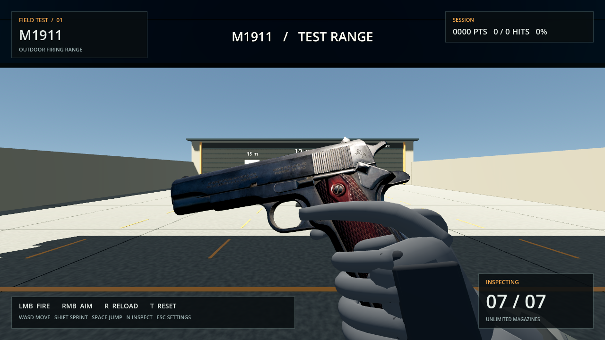
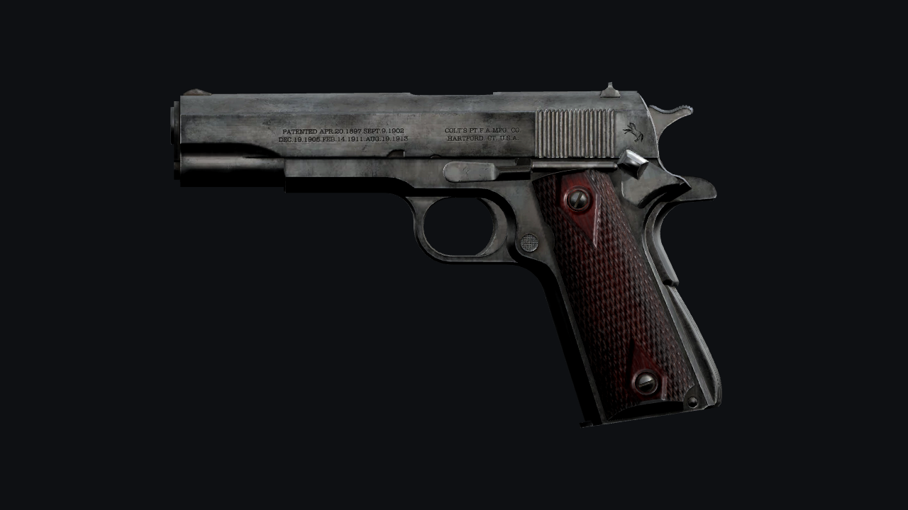
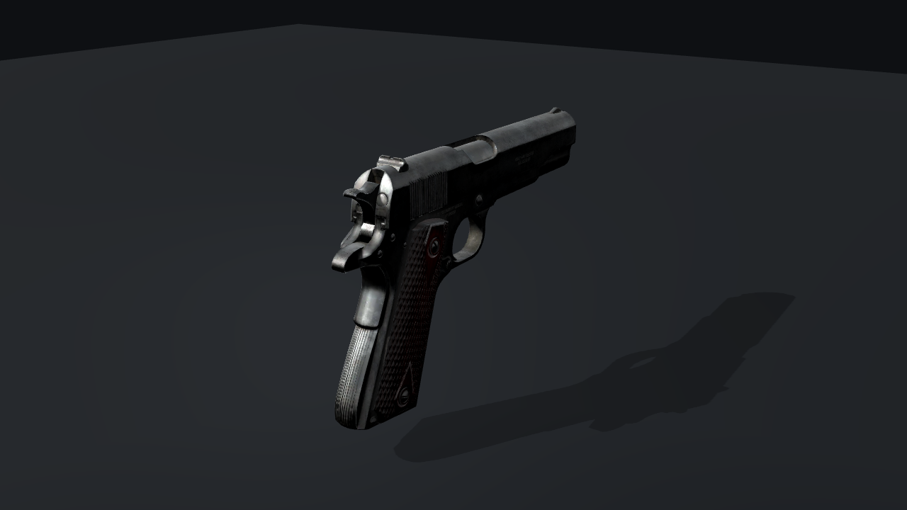

# M1911モデルの制作ノート

銃の外観には、egorbelous（e.belous）制作の「M1911 pistol」を使用しています。部品ごとの形状と作者のPBR素材を取り込み、ゲーム用のスケールと配置へ調整しました。今回の更新では形状を保ち、鋭すぎる光沢を抑えるために出力素材の粗さと銃専用の補助ライトを調整しています。射撃・リロード・感度設定・Nキーの確認モーション、音声、手のモデル、射撃場は従来どおりです。

提示された実物写真は見た目の方向性を確認する基準です。現在のモデルは作者の造形・表面表現に基づくため、写真の個体と細部や摩耗模様には差があります。

## 形状と素材

- フレーム、スライド、マガジンの3つのGLBに分けています。木製グリップはフレーム側に含まれ、スライドとマガジンは既存の射撃・リロードの動きに対応します。
- 部品に沿った摩耗、加工面の凹凸、暗い木製グリップの木目や細工を表示しています。形状・UV・ベースカラー・法線・AO・金属度は作者のデータを維持し、粗さだけを調整しています。
- 銃全体は約1.1万三角形です。2組の素材にそれぞれ1024×1024のベースカラー・法線・粗さ／金属度用画像を使います。細部は形状と法線マップの両方で表現しており、極端な接写での鮮明さにはテクスチャ解像度による限界があります。
- 同梱元モデルの腕・リグ・アニメーションを除去し、銃だけを使用しています。元データの2倍スケールを0.5倍にして、全長約216mmを基準にゲームへ配置しています。

粗さは、同梱元モデルを変更せず、再出力用のORM画像のGチャンネル（線形の0〜1）に次の変換を適用します。

- 金属：`max(0.34, sqrt(G))`
- 木部などの非金属：`0.08 + 0.92 * G`
- B（金属度）の `smoothstep(0.25, 0.85, B)` を重みにして両者を混合。

これにより金属の粗さの中央値は約0.20から約0.45へ、木部は約0.48から約0.52へ変わります。一定値で塗りつぶさず、作者の摩耗による粗さの差を残します。ORMのR（AO）・B（金属度）とアルファ、ベースカラー画像・法線画像は変更しません。

射撃場内では、`scenes/player.tscn` の銃専用ライト `ViewmodelFill` のエネルギーを1.4から0.9、スペキュラーを1.0から0.5へ変更し、強い白いハイライトを抑えています。通常の構えとNキーで見る左右の側面を比較し、刻印や部品の境界が読める設定にしています。手専用の補助ライトと射撃場の照明は変更していません。

## モデル単体の確認画像

Nキーの確認モーションで、光沢を抑えた質感を確認できます。

以下は実際のゲーム用モデルをGodotのスタジオ照明で描画した画像です。射撃場とは光源と背景が異なるため、ゲーム中の色や反射は[ゲーム画面](m1911-preview.png)で確認してください。

## 作者・出典・ライセンス

- 原作者：**egorbelous（e.belous）**
- 作品名：**M1911 pistol**
- [原作者の作品ページ](https://sketchfab.com/3d-models/m1911-pistol-80a0b8a6c4314da4a7b3a7cfe6cec1d4)
- ライセンス：[Creative Commons Attribution 4.0 International（CC BY 4.0）](https://creativecommons.org/licenses/by/4.0/)
- [採用した公開GLB（履歴版）](https://raw.githubusercontent.com/cktang88/3d-fps/964c79785962160412b9280b1b41b988a122145f/public/assets/models/fp/m1911.glb)
- ライセンス・作者表記の確認元：[cktang88/3d-fpsの個別素材クレジット](https://github.com/cktang88/3d-fps/blob/130ac2a5c856401ec36e7d35afcfefe40c5801f4/README.md#credits--licences)

ライセンス表記は、上記の再配布元READMEにある武器モデルの個別クレジットに基づきます。調査時は原作者の作品ページへアクセスできず、そのページでのライセンス再確認は行えていません。作者・出典・変更内容は配布ZIPにも含まれる[クレジット](../licenses/models/M1911.txt)に記載しています。

採用した公開GLBは、元のメーカー表記とPBR素材が残る履歴版です。このプロジェクトでは銃以外のデータの除去、量子化された頂点情報の展開、WebPからPNGへの画素を保った変換、ゲーム用の位置・スケール調整、3つのGLBへの書き出しを行っています。さらに実行用モデルの粗さを上記の式で調整しています。同梱元データ、元の刻印、摩耗模様は保ち、画像の拡大や摩耗模様の追加は行っていません。

## 再出力

リポジトリ直下で `python3 tools/build_m1911.py` を実行します。同梱した `tools/source_assets/m1911/m1911.glb` をBlenderで読み込み、ゲーム用のGLBとGodot用シーンを書き出します。素材の追加ダウンロードは不要です。

粗さの調整は `tools/adapt_m1911_blender.py` が再出力時に適用します。書き出し後、`tools/share_m1911_textures.py` がそのGLB内の画像を変更せず抽出し、同一画像を共有ファイルにまとめます。元モデルの出典・変換履歴・ハッシュは[同梱元データの説明](../tools/source_assets/m1911/README.md)、制作環境は[READMEの再生成手順](../README.md#モデル素材を再生成する)を参照してください。
